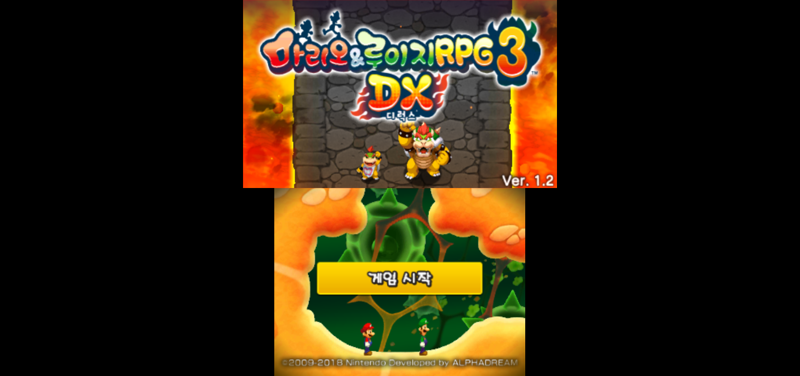
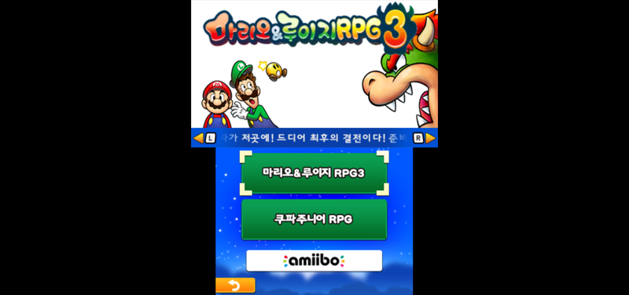
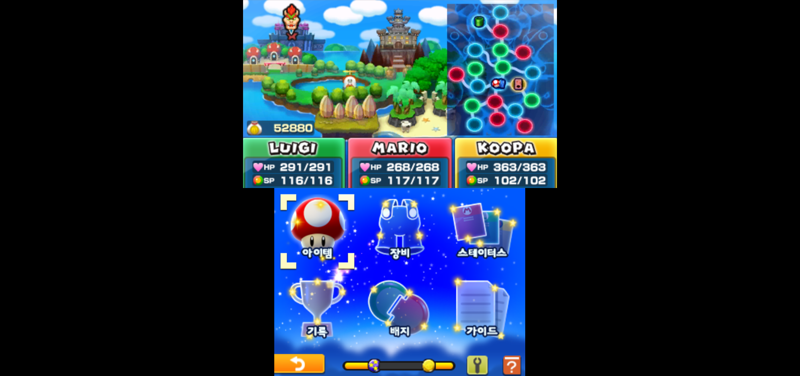

# 마리오&루이지 RPG3 DX 한글패치

닌텐도 3DS 일본판 『マリオ&ルイージRPG3 DX』를 위한 비공식 한국어 패치입니다. 본편과 「쿠파주니어 RPG」의 대사, 메뉴, 이미지 속 글자와 타이틀 로고를 한국어로 즐길 수 있습니다. 원작 DS 한국어판의 번역을 기준으로 하고, 리메이크에서 추가된 부분은 새로 번역했습니다.

## 다운로드와 설치

- [한글패치 다운로드 (최신 릴리스)](https://github.com/auseong325-design/mario-luigi-rpg-3dx-korean-patch/releases/latest) · 패치 기준일: 2026-11-16
  릴리스 페이지의 `ml3dx_ko_luma_20261116.zip`을 받으세요. [이전 버전](https://github.com/auseong325-design/mario-luigi-rpg-3dx-korean-patch/releases)도 릴리스에 판별로 있습니다.
- [자세한 설치 안내](설치%20안내.md)
- 직접 복사하기 어렵다면: [3DS 한글패치 매니저](https://github.com/auseong325-design/3ds-patch-universal-tool/releases)(통합 툴)를 실행하고 받은 ZIP을 창에 끌어다 놓은 뒤 「닌텐도 3DS」나 「PC」를 고르면 SD 카드나 Azahar 폴더에 넣어 줍니다. [자세히](설치%20안내.md#8-프로그램으로-설치하기-선택)
- HOME 메뉴의 배너와 게임 이름까지 한글로 바꾸고 싶다면: [통합판 패키지 (2026-11-20)](https://github.com/auseong325-design/mario-luigi-rpg-3dx-korean-patch/releases/tag/v2026.11.20-merged)를 [통합 툴](https://github.com/auseong325-design/3ds-patch-universal-tool/releases) v0.3.2 이상에 넣어 3DS용 CIA를 만들 수 있습니다. 공식 업데이트를 지우고 설치하는 방식이며, 3DS 본체에서 설치·실행을 확인했습니다.

**일본판 게임과 공식 Ver. 1.2 업데이트가 필요합니다.** 게임 본편, 업데이트, 설치툴은 ZIP에 들어 있지 않습니다. 파일은 Luma3DS용 SD 카드 경로로 구성되어 있으며 Azahar에도 수동 설치할 수 있습니다.

1. 3DS에서는 ZIP의 `luma` 폴더를 SD 카드 루트에 복사하고 Luma3DS의 **Enable game patching**을 켭니다.
2. Azahar에서는 ZIP 안 `luma/titles/00040000001CA900/`의 `romfs`와 `code.ips`를 해당 게임의 모드 폴더에 복사합니다.
3. 기존 패치나 세이브는 먼저 백업하고, 자세한 과정과 문제 해결은 설치 안내를 확인하세요.

패키지에는 New 3DS 계열용 **60fps 모드**가 들어 있습니다. 30fps로 사용하려면 게임 모드 폴더의 `code.ips`를 다른 곳에 옮기거나 제거하면 됩니다. New 3DS에서도 스타&스타나 기본 전투 커맨드 등에서 느려질 수 있습니다. 다른 60fps 치트는 함께 사용하지 마세요. [60fps 모드의 작동 방식·제작 크레딧·검증 범위](60fps%20안내.md)를 확인할 수 있습니다.

## 화면

아래는 Azahar에서 촬영한 화면입니다. 모드 선택과 메뉴 이미지는 통합판 시험에서 촬영했습니다.

| 모드 선택 | 스타 메뉴 |
|:---:|:---:|
|  |  |

## 알려진 사항

- 일본판 Ver. 1.2 전용이며 북미판·유럽판에는 적용할 수 없습니다.
- 이 저장소의 LayeredFS ZIP은 3DS HOME 메뉴의 게임 이름과 배너를 변경하지 않습니다. 한글 배너와 한국어 본체용 한글 게임 이름은 위의 통합판(CIA)으로만 바뀝니다.
- 게임 화면의 일부 임시 아이콘 6종은 원본 상태로 유지했습니다. 장면별 표시와 최신 60fps 수정의 실기 동작은 추가 확인이 필요합니다.
- 2026-10-31에 번역 자동 검토와 일부 장면의 Azahar 실행을 확인했고, 2026-11-16에 배포 전 최종 확인(DS 번역 대조·글자 폭)을 다시 했습니다. 모든 장면의 정상 작동을 보장하지 않습니다.

## 개발 과정

일본판의 대사와 화면 구성을 분석하고, DS 한국어판의 번역을 기준으로 대응되는 문장을 대조했습니다. 리메이크에 추가된 내용은 기존 용어와 말투에 맞춰 번역했습니다.

한국어 1DX의 글꼴과 로고 등 원작 자료를 활용해 한글 글자와 화면 이미지를 구성했습니다. 대사 제어 태그, 글자 폭과 누락 여부를 검사하고, Azahar와 실기에서 일부 화면을 확인하며 로고·메뉴와 60fps 동작을 다듬었습니다. 자동 검사와 일부 화면 확인이 전체 플레이 검증을 뜻하지는 않습니다.

## 권리 및 안내

이 프로젝트는 닌텐도 또는 원작 권리자의 허가·공인을 받지 않은 비공식 팬 패치입니다. 게임, 캐릭터, 상표와 원작 자료의 권리는 각 권리자에게 있습니다. 패치에는 원작 자료를 바탕으로 수정한 파일이 포함되며, 원작 자료에 대한 별도 이용 허락이나 오픈소스 라이선스를 부여하지 않습니다. 배포 또는 재이용에 필요한 권리는 각자 확인해 주세요.

패치는 어떠한 보증 없이 제공됩니다. 사용과 설치에 따른 결과는 사용자에게 있으며, 제작자는 사용 중 발생한 문제나 손해에 대해 책임을 지지 않습니다.