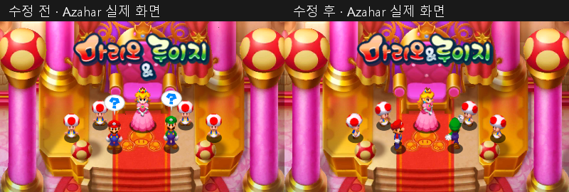

# 인트로 로고 정렬 수정 — Azahar 직접 검증, 2026-10-08

Codex 내장 Computer Use로 Azahar 2126.1.2에서 문제를 재현하고, 수정본을 다시 실행해 정렬을 확인했다. 패치·Azahar 정션·SD 폴더·배포 ZIP에 설치 완료.

## 원인과 수정

이전 레시피는 텍스처의 세로 행을 월드 Z의 반대 방향으로 해석했다. `&` 부모의 Z=153과 마리오/루이지의 Z=144 차이(+9)에 대해 텍스처 밑선을 +12행 더했는데, 실제 게임에서는 이 보정이 아래로 더해져 `&`가 두 단어 아래로 떨어졌다. 이전 파일 기반 투영의 정렬 결과는 실제 표시의 근거로 사용할 수 없다.

실제 행 방향에 맞춰 `baseline = BASE - (quad_Z - mario_Z) / .75`로 고쳤다. 인트로 `&`의 텍스처 밑선은 55.5에서 31.5로 바뀌었다. 결과 이미지는 이전 이미지의 가시 픽셀을 정확히 24행 위로 이동한 것이다. 잘린 픽셀은 없으며, 모양·색·광택·테두리 픽셀은 동일하다. 마리오/루이지의 텍스처, 메인 타이틀 bottom/top, 게임 시작 이미지 등은 바이트까지 그대로다. 모델 좌표·뼈대·애니메이션·가시성 전환 데이터도 변경하지 않았다.

현재 레시피는 `build_intro.py`이며 `work/img/logo2/run_all.py`도 이 레시피를 사용한다. 직전 `logo_assembly_contours_20261008`의 미리보기와 레시피는 역사 기록으로 남겼다.

## 실제 게임 확인

- 이번 세션에 제공된 bundled computer-use/26.1002.52244의 스킬·guidance·api·confirmations를 읽고 node_repl에서 `@oai/sky`를 직접 초기화했다. 이전 스킬 버전의 연결 실패는 `CONNECTION_STATUS.md`에 보존했다.
- 내장 도구로 게임 목록에서 3DX를 실행해 수정 전 `&` 하방 어긋남을 직접 확인했다. Azahar의 Ctrl+P로 `runtime_before.png`를 저장했다.
- F5로 에뮬레이션을 정상 중지한 뒤 감사된 수정본을 설치하고 다시 실행했다. 수정 후 `&`가 두 단어 사이에 붙는 장면을 확인하고 Ctrl+P로 `runtime_after_assembly.png`를 저장했다.
- F6 재시작 후 내장 도구의 8개 실제 창 캡처로 조립 유지, 화면 붕괴와 로고 분리·회전, 소용돌이로 작아지는 구간을 확인했다. 분리 시의 이동·회전은 원래 연출이다. 기록은 `runtime_sequence.json`과 `runtime_sequence_00`~`07.png`다.
- 최종 타이틀 화면에서 v1.2 표시와 승인된 로고, 두 실루엣, DX 중앙 배치를 확인했다. Ctrl+P 기록은 `runtime_after_title.png`다.
- 서브에이전트, Orca, 별도 Windows 입력 스크립트는 이번 검증에 사용하지 않았다. 설정 창은 취소했으며 재생 속도 등 사용자 설정은 변경하지 않았다. 검증 후 F5로 에뮬레이션을 중지했다.

비교 그림은 실제 Azahar 스크린숏의 상단 400×240 화면을 잘라 나란히 놓은 것이다. 합성 게임 장면이나 모델 미리보기가 아니다.

## 바이너리·배포 확인

- `art_verify.json`: 마리오/루이지 이미지 픽셀 동일. `&`는 가시 픽셀 손실 없는 정확한 −24행 이동.
- `build_verify.json`: FMdl의 `fmd_title_JP_ja/title_logo_and_JP` 텍스처만 변경. 그 밖의 BCH 전체와 모든 다른 모델은 바이트 동일. 디코드한 텍스처는 입력 PNG와 정확히 일치.
- `runtime_verify.json`: 실제 게임 재현 및 수정 후 정렬·이동·타이틀 확인 기록.
- `install.json`: patch/정션/SD/ZIP의 36파일 일치, ZIP CRC PASS. 기본 `work/build/fmdl_stage`도 동일한 파일로 동기화.
- FMdl SHA-256: `2d7819214886f6e973810940ff69f4096c254cd8da30381983e52ac519cefcad`.
- 배포 ZIP SHA-256: `428da773908cad063ab94c7343efcf9150d920fe6d84a0981e4a162bb4531450`.
- 이전 FMdl, ZIP 및 변경 전 입력 이미지: `work/build/prev_logo_runtime_fix_20261008/`. 원본 게임 파일은 수정하지 않았다.
